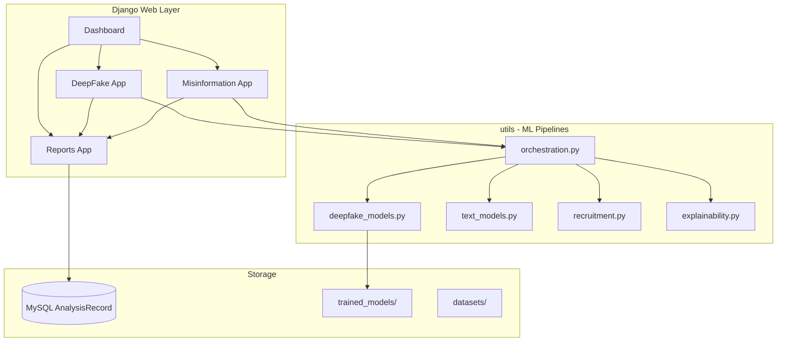

# Research architecture

## Dissertation title

**A Multi-Threat Explainable AI Framework for Digital Deception Detection and Evidence-Aware Authenticity Verification**

## System overview

## Module 1: DeepFake Image Detection

- **Model:** EfficientNetB0 binary classifier (TensorFlow/Keras)
- **Training:** `python manage.py train_demo_deepfake --dataset datasets` (or seed + train separately) on `datasets/real/` vs `datasets/fake/`
- **Inference:** `utils.deepfake_models.analyze()` — classifier + image forensics fallback
- **XAI:** Grad-CAM-style saliency heatmap (`generate_gradcam_heatmap`)

## Module 2: Misinformation Detection

Unified text-analysis module with two application areas:

### 2a. Fake News

- **Model:** HuggingFace BERT (`mrm8488/bert-tiny-finetuned-fake-news-detection`)
- **Pipeline:** `utils.text_models.analyze()` + text forensics blend
- **XAI:** LIME token attributions, SHAP-style feature bars

### 2b. Recruitment Scam (sub-module)

- **Not a separate research contribution** — applies misinformation detection techniques to fraudulent job posts
- **Pipeline:** `utils.recruitment.analyze()` — job-text forensics, employer reference list, domain TLD checks
- **XAI:** Same LIME/SHAP helpers as fake news

## Module 3: Explainable AI

| Method | Used in | Implementation |
|--------|---------|----------------|
| Grad-CAM | DeepFake | Saliency overlay on uploaded image |
| LIME | Misinformation (fake news & recruitment) | Token importance ranking |
| SHAP | Misinformation | Feature contribution percentages |

Centralized in `utils/explainability.py`, exported via `apps/explainability/services.py`.

## Data flow

1. User submits form (image or text) via Django view
2. View calls `utils.orchestration` pipeline
3. Pipeline runs ML inference + XAI generation
4. `apps.reports.services.persist_analysis` saves to MySQL (or session in demo mode)
5. Template renders result + `explain_panel.html`
6. PDF generated on demand via `utils.reports.generate_pdf_bytes`

## Technology stack

| Layer | Technology |
|-------|------------|
| Web | Django 4.2, Bootstrap-inspired CSS |
| Database | MySQL (XAMPP) |
| Deep learning | TensorFlow, HuggingFace Transformers |
| Reports | ReportLab PDF |
| Auth | Django built-in (`apps.accounts`) |

## Design principles

- **Thin views:** Django views handle HTTP only; ML logic lives in `utils/`
- **Single history table:** `AnalysisRecord` with `module` discriminator
- **Preserved database:** Existing `analysis_analysisrecord` table retained after refactor
