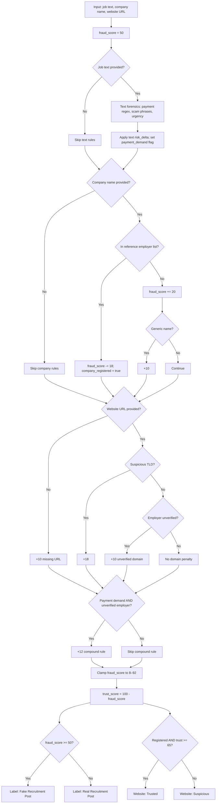

# Recruitment Heuristic Module — Specification & Evaluation

Phase-1 rule-based recruitment scam screening used in the multi-threat authenticity prototype.
Weights were derived from indicators reported in recruitment-fraud literature (payment demands, urgency language, employer verification gaps) and hand-tuned for interpretability—not learned from data.

## Scoring model

| Symbol | Meaning |
|--------|---------|
| `fraud_score` | Risk in [8, 92]; starts at **50** (neutral prior) |
| `trust_score` | Authenticity score = `100 − fraud_score` |
| Decision | **Scam** if `fraud_score ≥ 50`, else **Legitimate** |
| Website status | **Trusted** only if employer is in reference list **and** `trust_score ≥ 65`; otherwise **Suspicious** |

After all rules fire, `fraud_score` is clamped: `clamp(score, low=8, high=92)`.

Implementation: `utils/recruitment.py`, `utils/ml_utils.py`.

---

## Rules and weights

| ID | Category | Condition | Δ fraud score | Source / rationale |
|----|----------|-----------|---------------|-------------------|
| R0 | Baseline | Always | Start at 50 | Neutral prior before evidence |
| T1 | Text / payment | Regex: `\bpay\s*\d+\s*(rs\|₹\|rupees?\|/-)?` | +25 | Upfront payment demand [Fraud-BERT, EMSCAD-style ads] |
| T2 | Text / payment | Regex: `(registration\|interview\|joining)\s*(fee\|fees\|charge\|deposit)` | +20 | Fee keywords in post body |
| T3 | Text / payment | Regex: `\bpay\s*(rs\|₹\|now\|before\|to apply)\b` | +16 | Payment instruction phrasing |
| T4 | Text / phrase | Any scam phrase in list below | +14 each | Curated high-risk phrases (stackable) |
| T5 | Text / urgency | Regex: `\b(urgent\|immediate\|hurry\|act now)\b` | +8 | Pressure language |
| C1 | Company | Name substring-matches reference employer list | −18 | Known employer whitelist |
| C2 | Company | Name not in reference list | +20 | Unverified employer |
| C3 | Company | Generic name (abc/xyz/test/dummy/sample prefix, or ≤6 chars) | +10 | Only when C2 applies |
| D1 | Domain | TLD ∈ {`.xyz`, `.top`, `.click`, `.tk`} | +18 | Low-trust TLD heuristic |
| D2 | Domain | URL present, employer not registered, non-suspicious TLD | +10 | Domain not corroborated |
| D3 | Domain | No website URL provided | +10 | Missing employer web presence |
| X1 | Compound | `payment_demand` **and** employer not registered | +12 | Fee + unknown employer interaction |

### Scam phrase list (T4, +14 each)

`registration fee`, `interview fee`, `guaranteed placement`, `pay rs`, `pay ₹`, `immediate joining without interview`, `work from home earn`, `whatsapp earning`, `security deposit`

### Reference employer list (C1)

Tata, Reliance, Infosys, TCS, Wipro, HDFC, ICICI, SBI, Google, Microsoft, Amazon, Flipkart, Paytm, Airtel, Jio (16 names; substring match on lowercased company name)

---

## Decision flowchart

---

## Evaluation

### Dataset

- **File:** `data/recruitment_eval/labeled_posts.json`
- **Size:** 40 posts (20 legitimate, 20 scam)
- **Labeling:** Manually authored representative posts; binary labels (`real` / `scam`)
- **Legitimate set:** Mix of major employers on official domains and mid-size companies not on the whitelist (tests false-alarm behaviour)
- **Scam set:** Synthetic ads mirroring common Indian job-scam patterns (fees, urgency, suspicious TLDs, WhatsApp contact)

### Protocol

- Run `python scripts/evaluate_recruitment.py`
- Positive class = **scam**; prediction = module outputs `"Fake Recruitment Post"`
- Threshold fixed at `fraud_risk_score ≥ 50`
- Metrics: accuracy, precision, recall, F1; confusion matrix (TP/TN/FP/FN)

### Results (last run)

| Metric | Value |
|--------|-------|
| N | 40 (20 real, 20 scam) |
| Accuracy | **80.00%** |
| Precision | **71.43%** |
| Recall | **100.00%** |
| F1 | **83.33%** |
| TP / TN / FP / FN | 20 / 12 / 8 / 0 |

**Interpretation:** The module catches all scam posts (recall 100%) but flags eight legitimate posts from employers outside the 16-name whitelist (`real_14`–`real_20`) and one government-style post (`real_11`, SBI) that mentions application fees—triggering payment heuristics. This confirms the expected whitelist bias and the need for broader employer verification in production.

Full per-sample output: `data/recruitment_eval/results.json`

---

## Limitations (disclose in papers)

1. **Whitelist bias** — Unknown but legitimate SMEs receive +20 unverified-employer penalty.
2. **No learned semantics** — Paraphrased scams without lexicon hits may evade detection.
3. **Regex fragility** — Legitimate posts mentioning “application fee” (e.g. government recruitment) can false-positive.
4. **TLD-only domain check** — Scams on `.com` domains are not penalized by D1.
5. **Threshold 50** — Not tuned via ROC on a development split; fixed for interpretability.
6. **LIME/SHAP display** — Token/feature rankings are post-hoc helpers over fired rules, not library-based explainers on a trained classifier.

## Future work

- Fine-tune BERT on EMSCAD or institutional labels; compare against this heuristic baseline.
- Replace static whitelist with registry/API employer verification.
- Threshold tuning and per-rule ablation on a larger labeled set.
